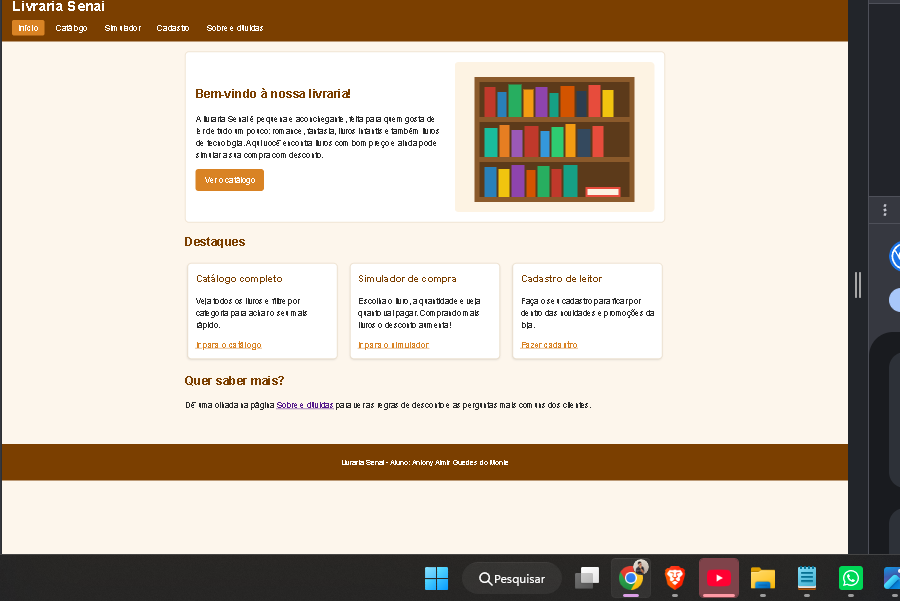
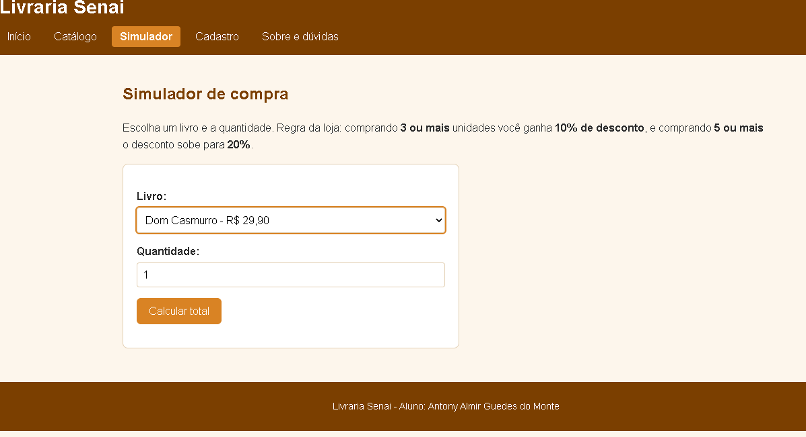
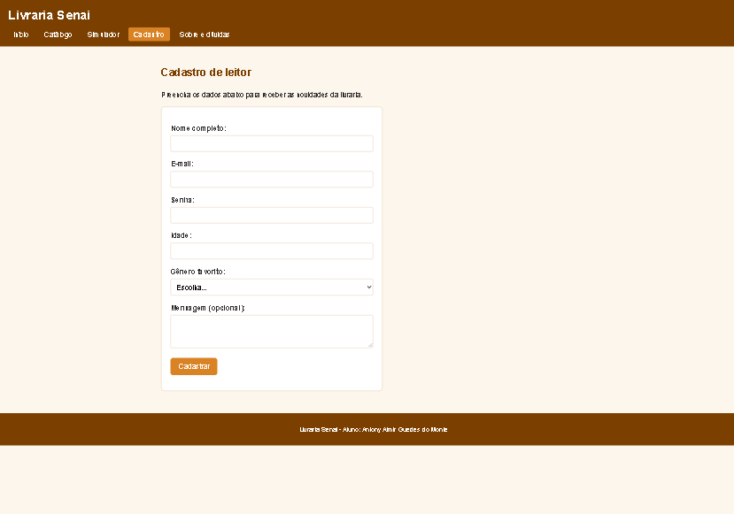
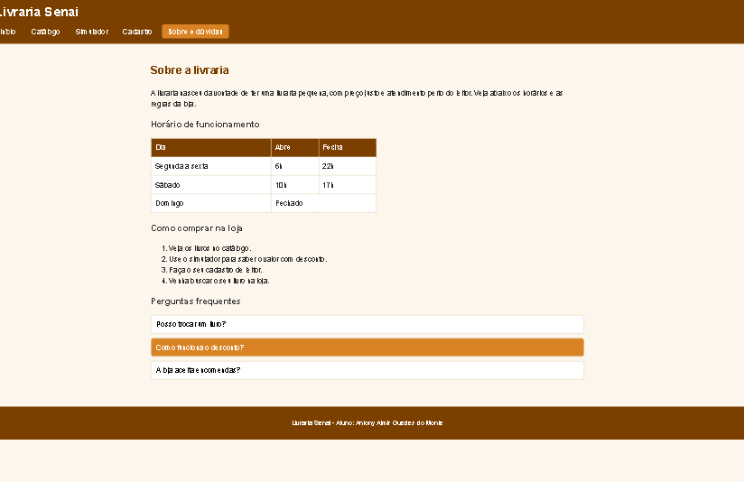

# Livraria Senai

Atividade prática: site de 5 telas sobre o tema **Livraria**.

## Descrição

É um site simples de uma livraria pequena. Dá para ver os livros, filtrar por categoria,
simular uma compra com desconto, fazer um cadastro de leitor e ler as perguntas frequentes.

## As 5 telas

| Tela | Arquivo | O que tem |
|------|---------|-----------|
| Início | `index.html` | apresentação, imagem, 3 destaques e links |
| Catálogo | `catalogo.html` | 8 livros criados por JavaScript, filtro por categoria e contador |
| Simulador | `simulador.html` | escolhe o livro e a quantidade e calcula o total com desconto |
| Cadastro | `cadastro.html` | formulário com 6 campos e validação com JavaScript |
| Sobre e dúvidas | `sobre.html` | tabela, lista ordenada e perguntas que abrem e fecham |

## Regra especial do simulador

- 3 ou mais unidades: 10% de desconto
- 5 ou mais unidades: 20% de desconto

## foi usado

- HTML5 com tags semânticas (header, nav, main, section, article, footer)
- CSS em um único arquivo, com variáveis em `:root`, flexbox, hover e media query para celular (até 600px)
- JavaScript em um único arquivo, com array de objetos, funções, filter, eventos de click e submit com preventDefault, if/else e validação

## Prints

Página inicial:

Catálogo:

Simulador:

Cadastro:

Sobre e dúvidas:

Versão para celular:

## Como abrir

Baixe a pasta e abra o `index.html` no navegador.
